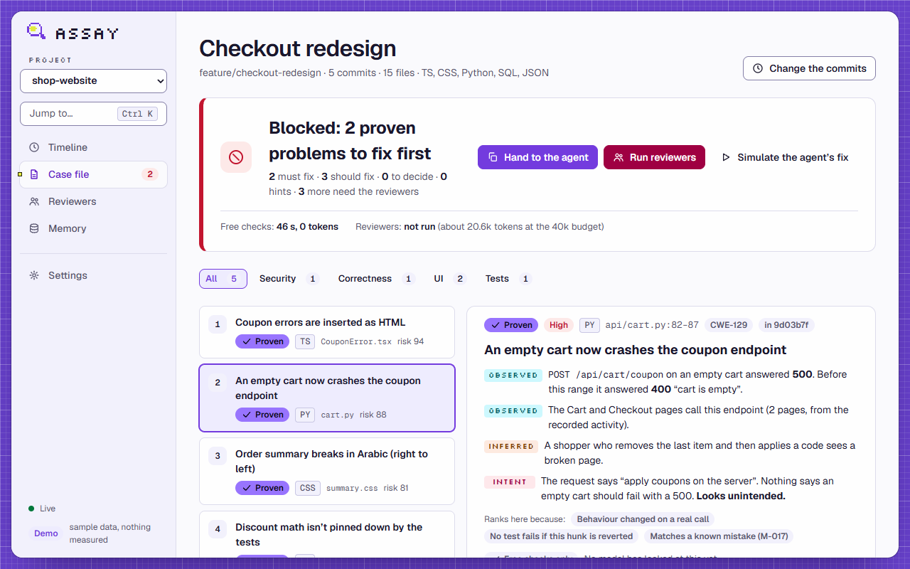

# Design

How Assay looks, behaves and speaks. **Read this before building or changing anything a person sees**: a screen, a report, a button, a message, a colour. Back to the [README](README.md).

Assay uses the "Arcade, window on the desk" design system. The source of truth for the tokens is [`demo/src/style.css`](demo/src/style.css); the HTML report ships a copy of it in [`packages/core/assets/report.css`](packages/core/assets/report.css). The clickable [demo](demo/index.html) is the spec for every screen, and the dashboard is built from it.

A standard here is a rule with an example you can open. Use the pattern; don't invent a second way.

## What the screens say

Assay's whole job is to tell you **how sure it is, and why**. The design carries that in three ways, and every screen keeps them apart.

**1. Evidence strength** is one violet, in three weights:

| | Look | Means |
|---|---|---|
| **Proven** | Solid violet fill, dark ink, a check | Something real was shown. It can block. |
| **Corroborated** | Soft violet with a violet outline | Two independent signals agree. It can't block. |
| **Hint** | No fill, a *dashed* neutral outline | One signal. Look, don't obey. |

The dashed outline is deliberate: a hint should look unfinished.

**2. Observed against inferred.** Every sentence about impact is tagged in the pixel font: an **Observed** tag (cyan) for what the diff, a run or a measurement showed, and an **Inferred** tag (orange) for what it might mean. An inferred sentence never blocks and never looks like a fact.

**3. Who said it.** Pink is the voice of an AI: reviewers, "an agent asked for this", the run-reviewers button. A finding that came from a deterministic check never uses pink. If a screen shows pink, a model was involved; if it doesn't, nothing was.

## The screens

| Screen | Its one job | Its main action |
|---|---|---|
| **Timeline** | Pick the commits: what the free checks found on each, risk by commit, a way to find where something broke | Open the case file |
| **Case file** | The verdict, the findings ranked by importance, the changed lines, the evidence, before and after | Hand to the agent |
| **Reviewers** | What would run, what it would cost, and (later) how each reviewer is doing | Run reviewers |
| **Memory** | The mistakes this project has made and the standards each is checked against | Add a detector |
| **Settings** | What Assay uses, and what it costs | |

The sidebar is by intent, project first: a project switcher, then the project's pages, then Settings. The current page's pip is the lime marker.

**In the dashboard** only the screens that exist are in the sidebar: Timeline, Case file, Reviewers, Memory and Settings. Reviewers is there too. A screen that can't do its job yet doesn't pretend to (the scoreboard waits for calibration) ("show what is true"). The dashboard also drops the demo's "sample data" badge, because everything on it is measured, and shows "Live" (and "Disconnected" when the server is gone) as a real state. The page that implements this is [`packages/web/public`](packages/web/public); [the dashboard guide](docs/DASHBOARD.md) describes what each screen does.

## The look

The app is **one sheet on a deep violet desk** whose 8 px grid shows only around the sheet. The gap around the sheet is `--sheet-gap` (`--s4`, `--s2` on narrow screens), applied as padding on the desk, never as a margin on the sheet. Light and dark are both first-class. Every colour is a token; **never write a literal colour**.

### Colour roles

| Role | Token | Light | Dark | Means |
|---|---|---|---|---|
| Action, evidence strength | `--accent` | `#733bde` | `#a890fe` | What you press; links; focus; the proven tier |
| AI's voice | `--second` | `#ed4074` | `#ff869f` | Reviewers, "AI said" |
| Where you are | `--marker` | `#e2e941` | `#e2e941` | The current page's pip, and nothing else |
| The desk | `--desk` | `#6741ca` | `#1d0a44` | What the sheet rests on |
| Page, card | `--bg`, `--surface` | `#fafafd`, `#fefefe` | `#0f0c1d`, `#181529` | |
| Raised, hover | `--surface-2`, `--surface-hover` | `#f2f1fc`, `#ecebfb` | `#211e36`, `#29253e` | |
| Text | `--text`, `--text-dim` | `#1a172c`, `#57546d` | `#eeedf8`, `#b0adc9` | A violet-tinted grey, never pure black or white |
| Borders | `--border`, `--border-strong`, `--border-control` | `#dddcec`, `#c9c7e4`, `#8580a8` | `#322e4b`, `#474266`, `#6e6895` | A control's edge is `--border-control`: 3:1 |
| Status | `--ok`, `--warn`, `--danger` (+ `-soft`) | `#00783b`, `#915b00`, `#c2152f` | `#56dc85`, `#fabb41`, `#ff7777` | Green fine, amber a warning, red a problem |

Six hues, tuned to the same weight in light and dark (`--h-violet|blue|cyan|lime|orange|pink` with `-fill`, `-ink`, `-soft`, `-text`, `-line`), carry **meaning, never decoration**, and a hue is never reused for a different meaning:

| Where | Hue |
|---|---|
| Observed tag | cyan |
| Inferred tag | orange |
| Evidence strength | violet (three weights, above) |
| Risk bar | lime (low), orange (medium), red (high) |
| Reviewer, AI | pink |

Severity is a badge in status colours: **High** red, **Medium** amber, **Low** neutral. Tone of the verdict card is its left border (6 px): red when blocked, amber when it can merge with fixes, green when clear.

### Type, space, shape

- **Geist** for reading, **Geist Mono** for anything a machine wrote (hashes, paths, code, ids), **Silkscreen** for the logo and for small labels (table headings, the Observed and Inferred tags, nav headings) and **never for a sentence**. The fonts ship with the code (`packages/core/assets/fonts`, all SIL OFL) and are embedded in the report, so nothing loads from a host.
- Scale: 11, 12, 13, **14** (base), 16, 18, 20, 24, 32 px. Spacing: 4, 8, 12, 16, 24, 32, 48. Radii: 8 (controls), 12 (cards), 16 (the sheet and dialogs). A control is 34 px high (28 for a small one). The sidebar is 232 px.
- The mark is a pixel magnifier with a lime sparkle, drawn from a grid of squares and shown at whole multiples so it stays sharp.

## Rules

### Seeing and attention

- **One job per screen.** A screen that needs more than about four groups is two screens.
- **Rank, then fold.** Findings are listed most important first, each saying *why it ranks there*. A long list folds after five ("Show all 8").
- **Recognition over recall.** Show choices; never ask for what Assay can find. The commit picker, the lens filter with counts, Jump to… (`Ctrl K`), pick-from-list fields.
- **Progressive disclosure.** The common case first, the rest one click away: *Visual* before *Raw*, the code before the measurements. Don't draw a zero-state: "nothing significant" is one line and the action that makes sense.
- **Say little.** Copy states what happened and what to do next, in plain words, naming the thing ("Price badge covers the product image · 48 × 23 px overlap"). No "please", no "simply", no jargon, no blame.

### Acting and flow

- **Friction in proportion to risk.** Reading is free. Anything that runs your code asks first (`allow-run`, from a terminal, by name). What can't be undone says so on the thing itself. Never confirm what can be undone; never let what can't be undone through on one click.
- **Safe exploration.** Dismissing a finding or marking it intended is recorded and shows an **Undo** right where it happened.
- **Outcomes live on the object.** A button that runs something shows a spinner, then its result on itself, then goes back ("✓ Reproduced"). A failure shakes the button and says why beside it. **No toast** for a button's own result.
- **Show before you spend.** What a run would cost is previewed before it starts, per reviewer, with the budget, and changing the budget changes the preview.
- **A co-pilot, not an autopilot.** The AI proposes and the person decides. Reviewers' claims are hints until evidence says otherwise; a proven finding can be dismissed only by a person; an agent can't turn running on. The interface never makes an AI's say-so look like proof.

### State and trust

- **Show what is true.** A status colour, a count and a "Live" are never decoration. A guess says it is a guess (the Inferred tag). Sample data says it is sample data: the demo carries a "Demo · sample data, nothing measured" badge on every screen.
- **Everything has an address.** A page, a selected finding, a range, a tab: `#/case?item=rtl&tab=ba`, so it can be bookmarked and shared, and the back button works.
- **Differential before absolute.** Whatever a browser or a test reports is shown against the base: only what is new counts. Say "Not there at 7b2cc6f".
- **Be honest about the network.** Assay talks to nothing but your computer. Say where something goes and what is never sent.
- **Secrets are never shown.** A masked value is `AKIA…(20 characters)`, wherever it appears, including the code around a finding.

### Diegetic: the thing says it itself

State and controls live **on the object they are about**, not in a detached alert. A card changes its edge; a button becomes a spinner and then a result; a measured problem is a red dashed box on the rendered page, positioned from the real layout, not drawn by hand. Prefer previews to forms: show what will happen, and let the person press the one button. Motion tells state (pulse while working, shake for "no", slide for arrival) and stops under `prefers-reduced-motion`; the same news then arrives as a colour or text.

### Overlays are flat

A part that draws over another surface (a dialog, the Jump-to palette, a menu, a tooltip) is **flat with a hairline border: no halo, no shadow.** Relief belongs only to parts that rest on the plain ground (the sheet on the desk). This was asked for twice; don't add a shadow to an overlay.

### The page's own rules (the dashboard)

- **Text reaches the screen only through the `html` tag** in `packages/web/public/js/lib.js`. It escapes every value unless the value is html another `html` tag made. There is no `innerHTML` with a string built by hand, no `eval`, no inline script, no inline style: the page's content policy would block them, and a test checks that it does.
- **Sizes and positions are numbers the page computed**, put in `data-css` and applied with the style object after rendering. Never text from git, a page or a test run.
- **A job is a panel, not a modal.** What is running, line by line, with a **Stop**, sits under the verdict. Its result stays there until the next run.
- **Locked means a command.** A button that needs a permission only a person can give shows a lock, and pressing it shows the exact terminal command with a *Copy* button. It never asks "are you sure" and never does it for you.
- **Measured boxes mark one kind.** A finding about overlap draws overlap boxes on the picture, not every problem measured there.

### The Reviewers screen speaks for an AI, and says what it can't do

Reviewers are the one place pink belongs: the cards that are working, the dispute callout, the reviewer strip. The screen is honest about what Assay does and doesn't do: it **can't run** the reviewers (Assay never calls a model), so there is no "Run" button that pretends to. It plans and prices (a preview says it is one), gives the person the words to hand their agent, and then watches what the agent reports. A token figure is labelled an estimate until the agent reports its own. Nothing a reviewer says is shown as more than it is: a claim is a hint, a confirmation makes it corroborated, a dispute changes nothing.

### The Scoreboard measures, and says how small the sample is

The Scoreboard is the one screen that judges the AI, so it holds itself to the same rules: a number is a count of planted bugs, not a score out of a hundred; a token figure is marked an estimate (`~`) until the agent reports its own; one run is shown as a hint ("caught none of 3; if it catches none next time, plans leave it out"), never as a verdict; and the free checks are a row of their own, first, because what costs nothing should be seen before what costs something. A reviewer left out of plans says so and says how to bring it back.

### Memory is not an AI (the Memory screen)

Memory is counted and mined by code, so **nothing on it is pink**: a learned pattern, a question and a pack of yours use the neutral and the violet badges, and "Cried wolf" is the only red. (The demo used pink for "Learned here"; that breaks "pink is the voice of an AI" and was changed when the screen was built.) A status is a word, never colour alone (*New, Active, Expiring, Cried wolf, Off, Question*), the stats bars use the stats tokens, and the destructive action (*Forget this*) asks twice, on the button, instead of with a dialog.

### The floor: never traded for style

- Text pairs measure **4.5:1** (3:1 for large text); control borders **3:1**. Measure a new pair; don't eyeball it. (Assay's own `look` does this to other people's pages.)
- Never colour alone: status also has words or an icon; a tier has a label as well as a weight.
- Real `<button>`, `<a href>`, `<input>` with a `<label>`. Everything reachable and usable by keyboard; focus is visible; targets are comfortable. A measured box has a text equivalent in the list under it.
- Works at phone width (the sheet stacks under 860 px) and with the window resized.
- Reduced motion is respected; every change a person must know is also announced to screen readers.

## Components

Each exists in the [demo](demo/src/style.css) with its class name.

| Component | Class | Notes |
|---|---|---|
| Verdict card | `.verdict` | Icon, headline, counts (must / should / to decide / hints), the actions, and a footer saying what ran and what it cost |
| Finding row | `.citem` | Rank, title, tier badge, language, file, risk. Selected: violet edge. Fixed or resolved: dimmed and struck through |
| Finding detail | `.detail-head`, `.meaning`, `.why`, `.revstrip` | Badges, the Observed and Inferred lines, "Ranks here because" chips, who looked at it |
| Diff | `.diff-grid`, `.diff-row.sig` | Old and new line numbers; the marked line (a violet bar on its left) is the one the finding is about |
| Evidence row | `.ev` | Kind, source, the sentence, the replay command, and a *Reproduce* button |
| Before and after | `.cmp-stack`, `.flags`, `.mcell` | Slider, side by side, or difference (black means unchanged); the eight combinations as a grid, each *clean* or *N problems*; red dashed boxes measured from the real layout |
| Timeline | `.tl`, `.riskstrip`, `.cell` | A lane of commits with a chip per check, risk bars, range selection (one, a range, the branch) |
| Pipeline | `.stepper`, `.step` | Free checks → triage → specialists → cross-exam → gate → verdict, with each step's state |
| Reviewer card | `.rcard` | Pink while running; dashed when skipped, with the reason |
| Token meter | `.meter` | Budget against what was used, by step; "tokens per reviewer-added finding" |
| Scoreboard | `.mx` | Which reviewer caught which planted bug: ✓ with proof, ~ without, ✗ missed |
| Jump to | `dialog`, `.pal-*` | `Ctrl K`: pages, commits and actions |

## Report and print

The HTML report is one file: fonts embedded, no external host, a few lines of script (switching findings, the slider). **Everything that came from git or a page** (subjects, paths, code, evidence text, a page's text) is untrusted and escaped. It follows the same tokens and works in light and dark.

## Before you ship anything a person sees

1. **Reuse before you write**: is there already a component, a class or a token for this?
2. **One job per screen**, with one main action; the rest folded or one click away.
3. **Say how sure it is**: tier, Observed or Inferred, and who said it (pink only for an AI).
4. **Outcomes on the object**: no toast for a button's own result; a failure carries its reason.
5. **Risk sets the friction**; anything reversible has an Undo.
6. **Show before you spend**; show what is sent before it is sent.
7. **Colour by meaning**: tokens only, in light and dark; measure new text pairs (4.5:1) and borders (3:1); never colour alone.
8. **Overlays are flat**: a hairline, no shadow.
9. **Accessible**: keyboard, labels, focus, reduced motion, phone width.
10. **Less text**: cut strings; no zero-state clutter; no jargon.
11. **An address**: a selection or slice is in the URL.
12. **Secrets masked**, always.
13. **Tests and docs**: a change to a screen updates the demo (the spec), the dashboard and its docs, and `npm run screenshots` if a picture changed. `npm test` opens the real dashboard in a real browser.

## Assay's own touches

The mark (a magnifier), the evidence-strength weights, the Observed and Inferred tags, pink reserved for reviewers, and the verdict card.
