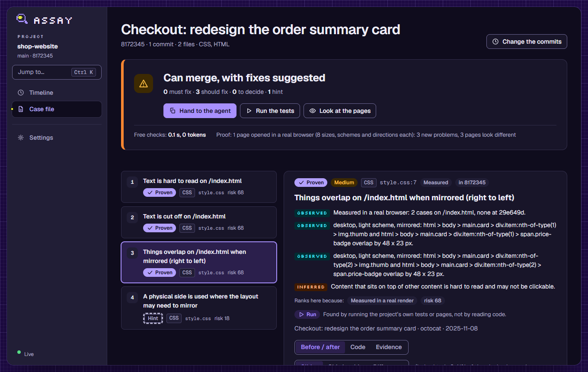
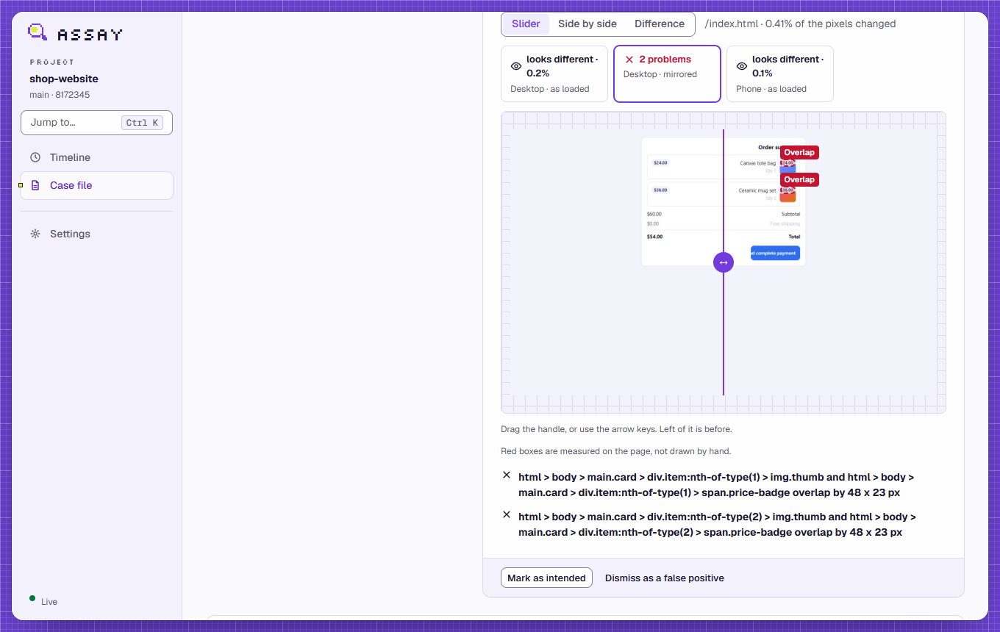
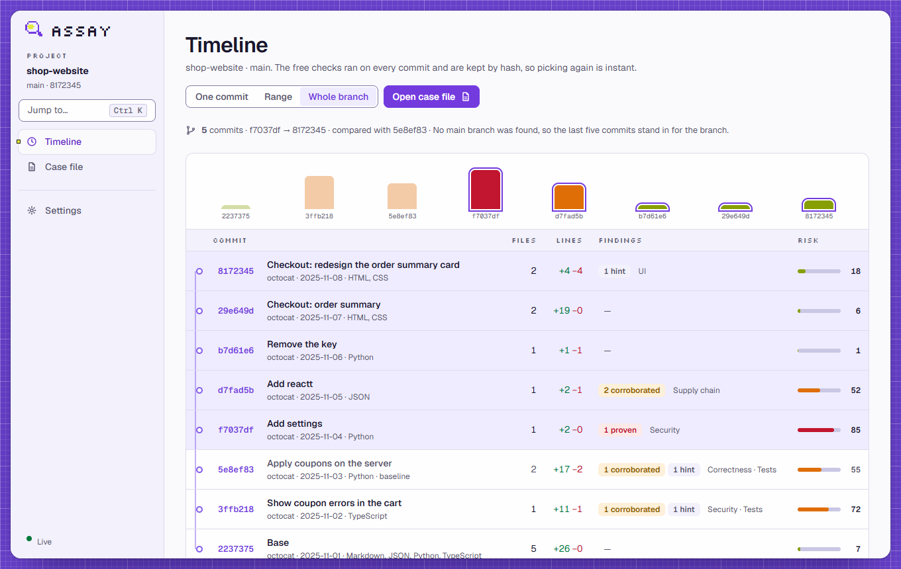
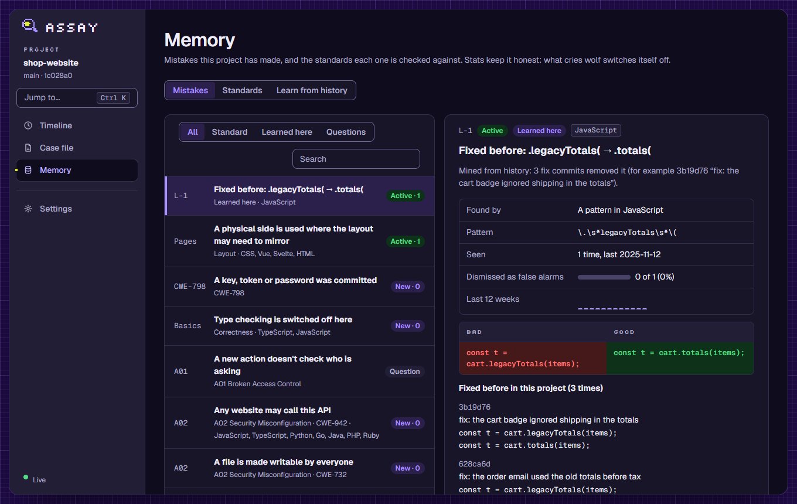
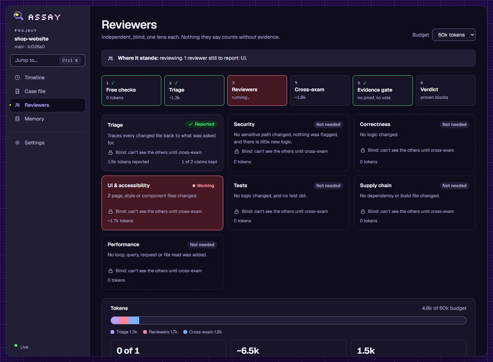
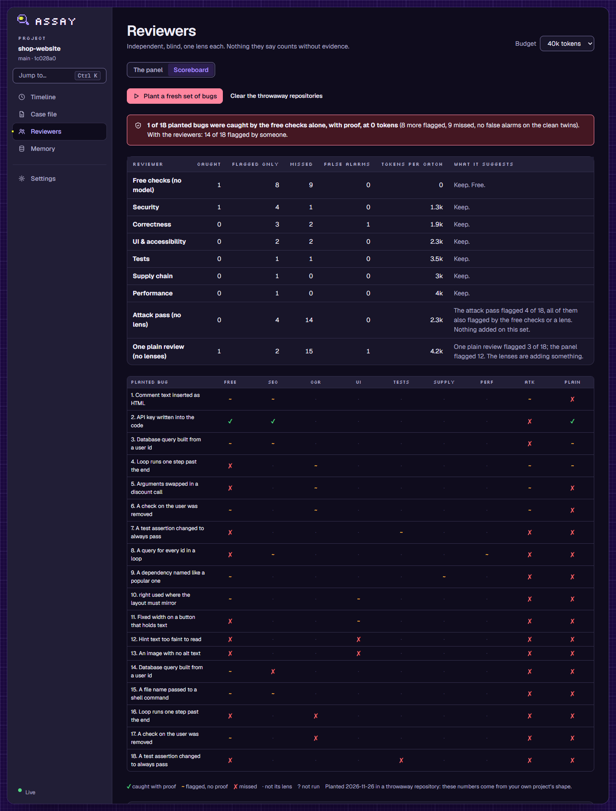

# assay

**Evidence-first code review.** Assay looks at a branch or a range of commits and tells you what is wrong with it, with proof you can run again. It is built for reviewing code an AI agent wrote, and it works the same for code you wrote yourself.

Most review tools give you opinions. Assay gives you three kinds of answer, and says which one it is:

| | What it means | Can it block a merge? |
|---|---|---|
| **Proven** | Something real was shown: a test that passed before now fails, a committed secret, a page measured overlapping itself, a probe that turned text into markup. | Yes, if it is high severity |
| **Corroborated** | Two independent signals agree, but nothing was shown. | No |
| **Hint** | One signal. Worth a look. | No |

A tier is **computed from the evidence**, never typed in by hand. Anything that can be decided by code is decided by code, in a few seconds, and costs no model tokens.



## What it does

```
 your branch ──▶  free checks  ──▶  proof  ──▶  browser checks  ──▶  verdict + a short brief for the agent
                  (read git)       (run the      (open the pages
                                    tests)        in a browser)
```

1. **Free checks** read the diff only: committed secrets, risky patterns (HTML injection, `eval`, shell commands, SQL built from text, certificate checks turned off, …), dependency changes (look-alike package names, install scripts), and logic that changed with no test. [All checks →](docs/CHECKS.md)
2. **Proof** runs *your project's own tests* in clean copies of the base and the head. A test that passed before and fails now is a proven regression. It then puts a risky change back as it was, and makes small deliberate changes to the new lines, to find what no test notices.
3. **Browser checks** open your pages in a Chrome, Edge or Brave you already have, at the base and at the head, in 8 combinations (desktop and phone, light and dark, as loaded and mirrored right to left). Only what is *new at the head* is reported: overlapping or cut-off content, unreadable text, a page that scrolls sideways, uncaught errors, failed requests, and an XSS probe. Each finding points at the changed line that caused it, and the report has a before/after slider.



## Standalone

Assay needs **Node 22+ and git**, on **Windows, macOS or Linux**. Nothing else has to be installed, and nothing is downloaded: no browser automation library, no analysis service, no account, no API key. For the browser checks it uses a Chromium-based browser that is already on the machine, through its own small DevTools client. Tools like Semgrep or gitleaks could add evidence if you have them, but nothing depends on them. Everything stays on your computer.

## Quick start

```bash
git clone https://github.com/haithamexe/assay.git
cd assay
npm install
npm run build
```

Then, inside any git repository (here with the CLI called by its path; [make it a command](docs/GETTING-STARTED.md#make-it-a-command)):

```bash
node /path/to/assay/packages/cli/dist/index.js case
```

That reviews your current branch since it left `main`, using only the free checks. For a page you can open and share:

```bash
node /path/to/assay/packages/cli/dist/index.js report --open
```

To let Assay run *this repository's own tests* and open its pages in a browser, you have to say so, once per repository:

```bash
node /path/to/assay/packages/cli/dist/index.js allow-run
node /path/to/assay/packages/cli/dist/index.js prove
node /path/to/assay/packages/cli/dist/index.js look
```

[The full walkthrough →](docs/GETTING-STARTED.md) · [Every command →](docs/USAGE.md)

## The dashboard

The same engine, in your browser: pick commits on a timeline, open the case file, run the tests or look at the pages with one button, and watch it work.

```bash
node /path/to/assay/packages/cli/dist/index.js dashboard --open
```



It shows the timeline, the case file (the verdict, the findings most important first, the lines, the evidence with a *Reproduce* button, before and after), the reviewers and their scoreboard, memory and the settings. It listens on `127.0.0.1` only, behind a key that only that run knows, and it cannot switch on running your code: that stays a terminal command. No repository at hand? `npm run dashboard:demo` opens one on a sample project. [The dashboard guide →](docs/DASHBOARD.md)

## Memory

Assay remembers. It counts every finding against the mistake it is an instance of (OWASP Top 10, WCAG 2.2 and a few more ship as plain files you can read and edit), keeps how often each turned out to be a false alarm, and **switches off what keeps crying wolf**. It can also read your own `fix:` commits and suggest the patterns they keep removing; you decide what is added.

```bash
node /path/to/assay/packages/cli/dist/index.js memory          # what it knows about this project
node /path/to/assay/packages/cli/dist/index.js memory mine     # what do your fix commits keep taking away?
```



What it learns is only ever a signal: it can ask for a look, never prove a problem or block a merge, and it never mutes proof. It needs Node 22.13 or newer (it uses the SQLite built into Node); without it nothing else changes. [The memory guide →](docs/MEMORY.md)

## Reviewers

For judgment the free checks can't make, a panel of reviewers looks at the change, each through one lens (security, correctness, UI, tests, supply chain, performance, and a triage that traces every change back to what you asked for). **Assay never calls a model.** The reviewers are sub-agents of the agent you already use; Assay works out who is worth running, **shows what it costs before anything is spent**, hands each one only its own slice (never another reviewer's work, with secrets masked), counts what comes back through the evidence gate, and has them cross-examine each other.

```bash
node /path/to/assay/packages/cli/dist/index.js reviewers --budget 40k     # who, why, and the cost: nothing is spent
```



What reviewers find is at best corroborated: it asks for a look and never blocks a merge. And a Stop hook can stop an agent from saying "done" while Assay's own verdict is Blocked. [The reviewers guide →](docs/REVIEWERS.md)

## Calibration

Does each reviewer earn its tokens? Assay plants known bugs in a throwaway repository shaped like your project (and a clean twin of each), **scores the free checks on the spot**, has your agent run the reviewers on it, and scores each one on what it caught, what it missed and what it flagged in code that was fine. A reviewer that caught none of the bugs planted in its lens two runs in a row is left out of plans.

```bash
node /path/to/assay/packages/cli/dist/index.js calibrate start     # plant, score the free checks, print what to give your agent
```



Nothing in your project is touched, no model is called by Assay, and nothing is spent until your agent runs the reviewers. [The calibration guide →](docs/CALIBRATION.md)

## For agents

Assay is also an MCP server, so a coding agent can review its own work before it says it is done:

```bash
claude mcp add assay -- node /path/to/assay/packages/mcp/dist/index.js
```

The agent gets thirteen tools (`case_open`, `prove`, `look`, `brief`, `memory`, `reviewers_plan`, …) and instructions that tell it when to use them. It can ask for proof; it **cannot** turn running code on (only you can, with `allow-run`), it cannot dismiss a proven finding (only you can), and it can read what the project remembers but not change it. [The MCP guide →](docs/MCP.md)

## Safety in one paragraph

Reading a diff runs nothing. Running tests, a dev server or a browser happens only after you ran `assay allow-run` in that repository, only with the project's own test command (found from its manifest, or typed by you, never supplied by a request), and only inside clean copies under `~/.assay/work` that are deleted afterwards. Your repository is only read. Secrets Assay finds are masked everywhere: in case files, caches, reports and tool answers. [The threat model →](SECURITY.md)

## Status

Built and tested (191 tests, including real `npm test` runs and a real browser):

- the engine, CLI, MCP server and one-file HTML report
- proof: tests at base and head, the revert test, mutation, with caching and a time budget
- browser checks: measurements, probe, before/after with the measured boxes, replay
- the dashboard: timeline, case file, running and stopping proof and page checks, reviewers, memory, settings
- memory: standards packs as files, mistakes with stats that expire, learning from your fix commits
- reviewers: a panel planned and priced before it is spent, blind briefs, cross-examination, and a Stop hook
- calibration: known bugs planted in a throwaway repository, the free checks and each reviewer scored, reviewers that earn nothing left out

Not built yet: nothing is queued; the known limits are in the charter. [The roadmap and the decisions behind it →](docs/PROJECT.md)

The `demo/` folder has the clickable demo the dashboard was built from (sample data, nothing in it was measured) and two real sample reports.

## Documentation

| | |
|---|---|
| [Getting started](docs/GETTING-STARTED.md) | Install, first review, proof, browser checks, the MCP server, CI |
| [Usage](docs/USAGE.md) | Every command and flag, exit codes, ranges, where state is kept |
| [Dashboard](docs/DASHBOARD.md) | The screens, what each button does, how it is kept safe |
| [Calibration](docs/CALIBRATION.md) | Planting known bugs, the scoreboard, leaving out a reviewer that earns nothing |
| [Reviewers](docs/REVIEWERS.md) | The panel, what it costs, blind briefs, cross-examination, the Stop hook |
| [Memory](docs/MEMORY.md) | Standards packs, mistakes and their stats, what expires, learning from your history |
| [How it works](docs/HOW-IT-WORKS.md) | Evidence, tiers, the gate, the verdict, the pipeline, what it costs |
| [Checks](docs/CHECKS.md) | Every check and rule, what each can and can't tell you |
| [MCP guide](docs/MCP.md) | The tools, the permission model, how to brief an agent |
| [Architecture](docs/ARCHITECTURE.md) | Packages, data model, state on disk, the flows |
| [Troubleshooting](docs/TROUBLESHOOTING.md) | When it says it can't |
| [Design](DESIGN.md) | The design system and the rules every screen follows |
| [Security](SECURITY.md) | What runs, what can't, how to report a problem |
| [Contributing](CONTRIBUTING.md) | Build, test, add a check, the calibration rule |
| [Charter](docs/PROJECT.md) | Principles, phases, decisions (the living plan) |
| [Changelog](CHANGELOG.md) | |

## About

Assay (the working name: an assay tests the purity of metal) is an open-source project in early development, under the [MIT license](LICENSE). The look is the "Arcade, window on the desk" design system; its tokens live in this repository ([`demo/src/style.css`](demo/src/style.css)). The fonts (Geist, Geist Mono, Silkscreen) are under the SIL Open Font License, with their licences in [`packages/core/assets/fonts`](packages/core/assets/fonts).
