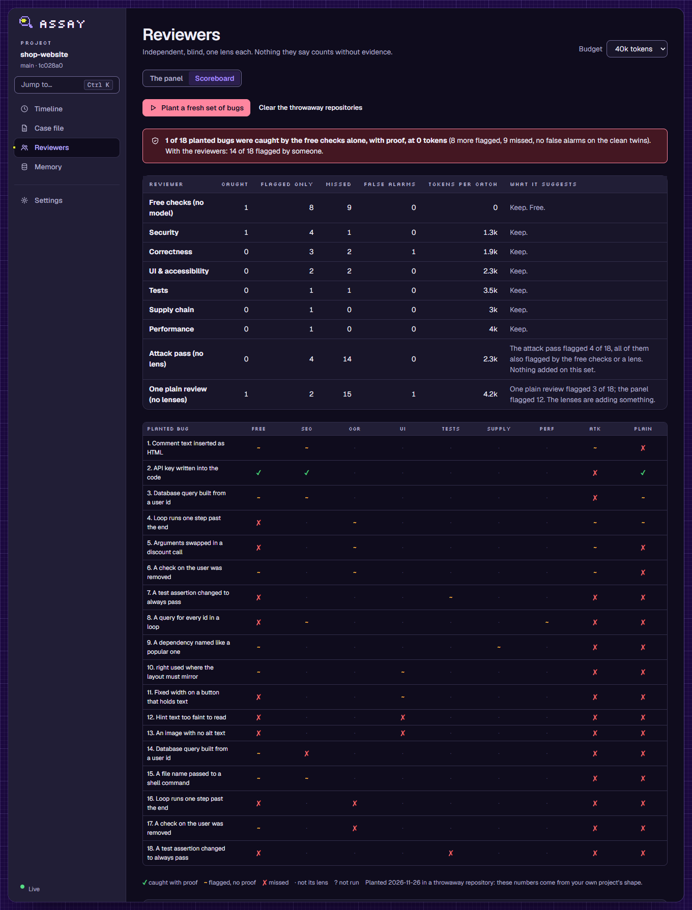

# Calibration

Does each reviewer earn its tokens? Plant known bugs, and find out. Back to the [README](../README.md).

A reviewer's opinion of itself is worth nothing, and a model's confidence is worth little more. Calibration replaces both with a measurement: Assay plants bugs it knows about in a throwaway repository, **scores the free checks on the spot**, has your own agent run the reviewers on it, and scores each reviewer on what it caught, what it missed, and what it flagged in code that was fine. A reviewer that doesn't earn its tokens is left out of future plans.



**Assay never calls a model**, here as everywhere. The free checks are scored without one. The reviewers are run by your agent (the same panel as [Reviewers](REVIEWERS.md)), and Assay does the planting and the scoring.

## How a run works

```bash
assay calibrate               # what would be planted in this project
assay calibrate start         # plant it, score the free checks now, print what to give your agent
assay calibrate score         # the scoreboard again (it moves as the reviewers report)
assay calibrate clean --all   # remove the throwaway repositories (what each showed is kept)
```

1. **A throwaway repository, shaped like your project.** Assay looks at which languages your project uses and which folders hold them, and makes a small repository under `~/.assay/calibration` with a base commit and two branches from it. It holds only the files being planted: **your own code is never copied, and nothing in your project is touched.**
2. **The bugs, and their clean twins.** On one branch, the bugs. On the other, the same code written correctly. A bug is a line Assay knows the position of, so there is no judging whether a reviewer "found" it: it either flagged that line (within three lines of it) or didn't.
3. **The free checks are scored at once.** Each bug is **caught with proof**, **flagged without proof**, or **missed**, and every flag on the clean branch is one of Assay's own **false alarms**.
4. **Your agent runs the reviewers on both cases**, with the words the screen (or `assay calibrate start`) gives you. The planted case and its clean twin look like any two cases, with ordinary file names and the same commit message, so a reviewer can't tell which holds the bugs. The prompt tells the agent not to read Assay's calibration folder, and that is an honor system: it only means something if the reviewers don't cheat.
5. **The scoreboard fills in as they report**, and is worked out from the two cases each time, so there is nothing to refresh by hand.

## What it plants

17 to 18 kinds of bug, whichever fit the project (a kind that doesn't fit is listed as left out, with the reason):

| Lens | Bugs |
|---|---|
| Security | comment text inserted as HTML · an API key written into the code · a query built from a user id (JS and Python) · a file name passed to a shell command |
| Correctness | a loop one step past the end (JS and Python) · arguments swapped in a call · a check on the user removed (JS and Python) |
| Tests | an assertion changed to always pass (JS and Python) |
| Performance | a query for every id in a loop |
| Supply chain | a dependency named like a popular one |
| UI | `right` where the layout must mirror · a fixed width on a button · faint hint text · an image with no alt text |

Some of these the free checks can catch (a committed key is proven; an HTML sink is flagged); others only a reviewer can (a loop that runs one step too far has no pattern), or only a browser (a fixed width). **That is the point of the table:** it shows what the reviewers add that the free checks can't, and what they cost for it. The templates are in `packages/core/src/calibration/bugs.ts`.

## The baseline: one plain review

A panel of reviewers costs several times what one review costs, so the scoreboard also measures **one plain review** against it. In a calibration run only (never in a real review), a plain review is planned on both cases: one reviewer with **no lens, no free findings and no questions**, handed the whole change (tests included) and told to review it as one capable engineer would. That is what you would have had without Assay's lenses.

- Your agent runs it like the others: `reviewer_brief` with lens `plain`, then `finding_submit` with reviewer `Plain` and `done: true`. The prompt from `assay calibrate start` says so.
- It gets a row, **One plain review (no lenses)**, and a column in the matrix. Every planted bug is a chance for it, because it has no lens of its own to miss in. Its false alarms are what it flags on the clean twin, and its tokens per catch count the whole diff.
- The row's advice says what the lenses add: *"One plain review flagged 3 of 18; the panel flagged 11. The lenses are adding something."*, or *"No gain from the lenses on this set."* if they don't. The headline is the point: you find out whether the panel earns its extra tokens on your project, or whether one plain review would have done.
- It is blind like the rest, and what only it claimed is **not** cross-examined (it is a measuring stick, not part of the panel). It never counts toward leaving a reviewer out of plans.

## The attack pass, scored

A calibration run plans the attack pass too, on a budget big enough for it (200k by default), and your agent runs it like the others (`reviewer_brief` with lens `attack`, `finding_submit` as `Attack`). It gets a row, **Attack pass (no lens)**, and a column (*Atk*) in the matrix.

- It has no lens, so there is no "own lens" for it to miss in: every planted bug is a chance, as for the plain review. Its false alarms are what it flags on the clean twin; its tokens per catch count what it read.
- The number that matters is what it adds. The advice says how many of the bugs it flagged **nothing else flagged** (neither the free checks nor any lens): *"The attack pass flagged 3 of 18, and 2 of them nothing else flagged. It earns its tokens here."*, or *"…all of them also flagged by the free checks or a lens. Nothing added on this set."*
- What it flagged counts toward "flagged by someone". It is never left out of plans by calibration (leaving out is by lens, and it has none): the row is for you to judge whether the 80k budget it needs is worth it on your project.

## Reading the scoreboard

| Column | Meaning |
|---|---|
| **Caught** | planted bugs the reviewer flagged, where the finding at that line is **proven** by something (the free checks, usually): "with proof" |
| **Flagged only** | flagged, with nothing but a reading behind it |
| **Missed** | a bug **in its own lens** that it didn't flag |
| **False alarms** | flags on the clean twin |
| **Tokens per catch** | what it cost, over its catches. Estimated (about four characters to a token, marked `~`) unless the agent reported its use |
| **What it suggests** | *Keep*, *Keep and watch it*, *caught none of N*, *N false alarms for M catches*, or *left out of plans* |

The matrix below it shows each bug against each reviewer: **✓** caught with proof, **~** flagged without proof, **✗** missed, **·** not its lens, **?** not run. A reviewer that flags a bug outside its own lens gets credit for it.

The headline is the useful number: *"1 of 18 planted bugs were caught by the free checks alone, with proof, at 0 tokens. With the reviewers: 14 of 18 flagged by someone."*

## Replaying your own history

The planted bugs are invented. Your own fix commits are real. `assay calibrate history` uses them as a second benchmark:

```bash
assay calibrate history           # which past bugs would be replayed (nothing is kept)
assay calibrate history start     # open those commits as cases, score the free checks at once, print what to give your agent
assay calibrate history score     # the scoreboard again (it moves as the reviewers report)
assay calibrate history clean     # forget the last replay
```

1. **Find the fixes.** The last 400 commits are read for fixes: a subject that starts with `fix:`, `bugfix:` or `hotfix:`, or says it fixes something (never a `refactor:`, `docs:`, a revert or a merge), one parent, not a bulk change.
2. **Find where each bug came in.** A fix removes lines. `git blame` on the fix's parent says which commit last wrote each removed line, and where that line sits in that commit's version of the file. That line, in that commit, is the truth. It must be a line that commit added, and the commit must be an ordinary one (one parent, not a bulk change). At most two bugs per fix, up to 12 in all (`--limit`, at most 40).
3. **Each of those commits is a case of its own**, with the same panel as any case (the lenses, the attack pass on a big enough budget, and one plain review), at 100k tokens a commit by default (`--budget`). The free checks are scored on it at once: caught with proof, flagged without proof, or missed.
4. **Your agent runs the reviewers**, with the words `assay calibrate history start` prints. It is told not to look at any commit after a case's head, because the fix is there (an honor system, like the planted run).
5. **The scoreboard** shows each of the free checks, each lens that ran, the attack pass and the plain review against every past bug, on the Scoreboard tab as well as in the terminal (the page shows it, and can't start one).

What it is, and isn't:

- **A proxy, and it says so.** A line a fix removed is not always the defect: a fix can rewrite code around it. Only commits that say they are fixes are used, so it is a sample of your own history, not a verdict.
- **No false alarms are counted.** Nobody knows that the rest of a commit is clean, so a flag that landed on none of the past bugs is listed as "elsewhere", for information.
- **Real cases.** These are ordinary cases of your project (a commit against its parent), unlike the throwaway ones. They are read from git and nothing in the project runs.
- **Small samples.** A project with few fixes gives few bugs. A reviewer's lens isn't known for a real bug, so reviewers are scored on whether they flagged it at all.
- **It doesn't change routing.** Leaving a reviewer out of plans still comes only from the planted runs.

## Routing a reviewer out

A reviewer is **left out of plans** when, in each of its **last two finished runs**, bugs were planted in its lens and it caught **none** of them. One run is a hint, shown in "what it suggests"; two in a row is a record. A run is finished when every planned reviewer has reported on both cases, and counts once.

A reviewer that is left out says so in the plan (`Left out: it caught none of the 6 bugs planted in its lens in the last 2 calibration runs. Bring it back with: assay reviewers plan --include ui`), saves its tokens, and can be brought back for a plan with `--include` (the CLI) or `include` (the MCP planning tool). Calibrate again and it earns its place back. A free-only budget says "off", not "left out".

## What it can't tell you

- **A model varies from run to run.** A reviewer that catches 3 of 5 today may catch 4 tomorrow. That is why one run only advises and two in a row decide, and why you can run it again.
- **The bugs are Assay's, not your project's.** They are realistic and shaped like your languages, but a reviewer's record on them is a proxy for its record on your real code. Replaying your own fix commits (above) is a better measure, and a small one.
- **Planted bugs are fixed in number.** A reviewer that is good at a kind of bug that isn't planted (a race, a rounding error) gets no credit for it.

## Safety

Calibration reads git and writes only under `~/.assay/calibration`. It runs none of your code (the free checks only read the diff), makes no network call and spends no tokens. The throwaway repositories are removed by `assay calibrate clean` and, past the newest five, when a new run starts. What a finished run showed (a few numbers per reviewer) is kept in `~/.assay/calibration/<project>.json`. The throwaway cases belong to no project, so the dashboard won't open them as yours.
