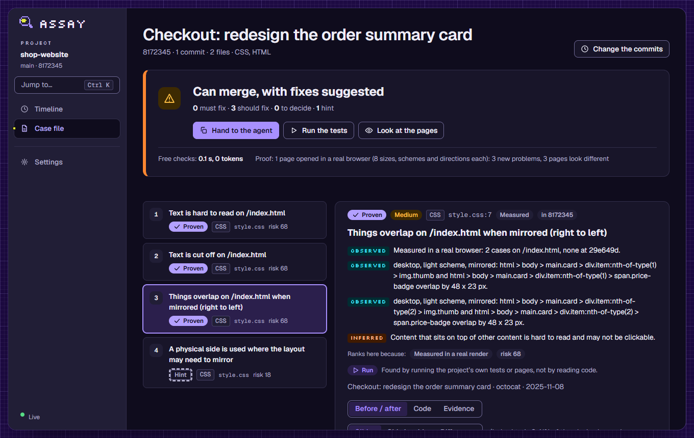

# The dashboard

The same engine as the command line, in your browser: pick commits on a timeline, open the case file, run the tests or look at the pages with one button, and watch it work. Back to the [README](../README.md). The screens were agreed as the clickable demo in [`demo/`](../demo/index.html) and follow the [design rules](../DESIGN.md).



## Start it

Inside a git repository:

```bash
assay dashboard            # prints an address; open it
assay dashboard --open     # and opens it for you
assay dashboard --port 4747 --repo /path/to/repo
```

The address has a key in it (`http://127.0.0.1:52341/?token=…`) that only this run knows. Open it once: the page keeps the key in a cookie it can't read, takes it out of the address bar, and you are in. Press `Ctrl+C` in the terminal to stop it (anything it was running is stopped too).

No repository to hand? `npm run dashboard:demo` (from the Assay folder) starts it on a sample project, `shop-website`, with planted mistakes and a checkout redesign that breaks the mirrored layout. It lives in a temporary folder with its own state, and running its tests and pages is switched on for it, so every button works.

One dashboard shows one repository. Start another on another port for another repository.

## The screens

| Screen | What it is for |
|---|---|
| **Timeline** | What the free checks found on each recent commit, the risk of each, and a way to pick the commits a case is about |
| **Case file** | The verdict, the findings most important first, and for each one the lines, the evidence and, where there are pictures, before and after |
| **Reviewers** | Who is worth running for this case, what it costs before anything is spent, and how far the panel has got. [The reviewers guide →](REVIEWERS.md) |
| **Memory** | The mistakes this project has made before, the standards each is checked against, and what its own git history teaches. [The memory guide →](MEMORY.md) |
| **Settings** | What Assay may run here, what it found on this computer, the theme |

`Ctrl K` (or `⌘ K`) opens *Jump to…*: pages, commits, and the actions of the open case. Every slice you look at has an address (`#/case?id=…&item=…&tab=…`), so you can bookmark it, and the back button works.

The demo's *Scoreboard* (planting bugs to see which reviewer earns its tokens) comes with its phase (calibration), and the sidebar shows only what exists.

### Timeline

Pick what a case is about:

- **One commit**: click a commit. The case is that commit against its parent.
- **Range**: click one commit, then another. The case is everything after the parent of the older one, up to the newer one.
- **Whole branch**: since the branch left `main`, or the last five commits when there is no default branch (it says so).

The risk strip above the table is every commit's risk, oldest to newest; the picked ones are outlined. *Findings* is what the free checks found on that commit by tier, with the lenses they are about. Below the table are the cases kept for this project: opening one is instant and keeps what was run.

While the page is open it watches the repository. When a new commit arrives, a note says so and offers *Refresh*, so an agent can commit while you watch.

### Case file

**The verdict** says blocked, can merge with fixes, or clear, and the counts behind it: must fix, should fix, to decide, hints. Only a proven finding of high severity blocks. Under it:

| Button | What it does |
|---|---|
| **Hand to the agent** | Shows the short fix brief an agent would receive, with a *Copy* button |
| **Run the tests** | Runs the project's own tests at the base and at the head (and the revert test and mutation), as [`assay prove`](USAGE.md#proof) does |
| **Look at the pages** | Opens the pages in a browser at the base and at the head, as [`assay look`](USAGE.md#proof) does |

Both run buttons are marked with a lock until running is [allowed](#running-your-code). While one runs, a panel under the verdict says what it is doing, line by line, and has a **Stop** button. Stop kills a test run's whole process tree at once; a page check stops before the next page. A stopped run keeps nothing. When it finishes, the panel shows what it found and the case updates in place. Only one run goes at a time; others wait their turn.

**The findings** are listed most important first, each saying why it ranks there, and can be filtered by lens. Pick one to read it:

- the badges (tier, severity, language, where, which commit), then what was **Observed** (the diff, a run or a measurement showed it) and what is **Inferred** (what it might mean, which never blocks);
- **Code**: the changed lines, with the one the finding is about marked;
- **Evidence**: each piece, with the command that replays it and a **Reproduce** button. Reproduce runs the check again from scratch and says whether the same thing came back. A reviewer's reading can't be replayed, so it has no button;
- **Before / after**, when pictures were taken (see below).

**Dismiss as a false positive** and **Mark as intended** take a finding off the verdict, and show **Undo** right where you pressed. A case can't be changed while a run is using it.

### Before and after

After *Look at the pages*, a finding about a page shows the pictures Assay took at the base and at the head:

- a **slider** (drag it, or use the arrow keys), **side by side**, or **difference** (orange is what changed);
- a cell for each picture taken: desktop as loaded, desktop mirrored (right to left), phone, each saying *no visible change*, *looks different* with the share of pixels, or *N problems*;
- **red boxes**: what the browser measured in that very picture and was not there at the base, placed from the page's real layout (not drawn by hand). A finding marks only its own kind: the overlap finding shows overlaps, not contrast.

The pictures live in the state folder (`shots/<case>/`). If one is gone, the page says so and says how to take it again.

### Reviewers

The plan for the case you have open (the whole branch if none is): a **budget** box, a **preview** of who would run and why the others wouldn't, the six steps (free checks, Triage, reviewers, cross-exam, evidence gate, verdict), a **card per reviewer** (will run, waiting, working, reported, or why not), a **token meter** (an estimate, counted by characters, until the agent reports its use) with how many findings the free checks already proved at no cost, and the words to give your agent. **Plan these reviewers** keeps the plan with the case.

**Assay never calls a model, so this screen can't run the reviewers.** Your agent does, from the prompt on the screen. While a panel is running the screen follows what the agent reports (it asks every few seconds): who is working, who has reported, what the evidence gate kept and dropped and why, and any disputes from cross-examination. The case file's verdict card says where the panel stands, and a disputed claim says so under the finding. The budget is only a number, so the page may set it; it can't start, spend or run anything.

The **Scoreboard** tab (on the Reviewers screen) is [calibration](CALIBRATION.md): before a run it says what would be planted in this project; **Plant bugs and test the reviewers** makes the throwaway repository (a job) and scores the free checks at once; then it shows the words to give your agent, and fills in as the reviewers report: a table (caught with proof, flagged only, missed, false alarms, tokens per catch, what it suggests) and a matrix of every planted bug against every reviewer. A reviewer calibration left out of plans is listed, with the way to bring it back. The page can plant and clear throwaway repositories, which reads git and writes only under Assay's own folder; it can't run a model or your code. Below it, **From your own history** shows the last [replay of your own fix commits](CALIBRATION.md#replaying-your-own-history): the free checks scored on the commit each past bug came in at, and each reviewer, the attack pass and the plain review as they report. The page only shows it: starting one is a command, because it opens cases.

### Memory

Three tabs, as in the demo, on real data:

- **Mistakes** lists every entry (standard ones from the packs, and learned ones), filtered by kind (*Standard*, *Learned here*, *Questions*) and searched as you type. Each shows what finds it, how often it was seen here, how many were dismissed as false alarms, the last twelve weeks, a bad and a good example, and whether it is matched in the case that is open. You can **switch it off** or on; a learned entry can also be **forgotten** (press twice). An entry that cries wolf says so, and switches itself off.
- **Standards** lists the packs with a checkbox each, how many of their rules Assay checks and how many are questions for a reviewer. It says where a pack of yours goes.
- **Learn from history** reads the git history (a job, with *Stop*; it runs no project code) and shows what fix commits keep removing, marked *Worth a detector* or *Weak*, each with the commits, what the fixes put in its place and an example. *Add detector* adds it. If nothing recurs it says so.

In the **case file**, a finding that matches an entry shows it under the finding: its name (a link to the entry), standard or learned, how often it has been seen in this project and how many were false alarms. Dismissing a finding there counts as a false alarm for those entries.

Changes on this screen change what the free checks report, so the timeline and the next case you open analyse the affected commits again, once. A case you already opened keeps what it found until you open it again. Nothing here can set `allow-run`, and the page can't send a pattern of its own: it can only add a suggestion that came from this project's history.

## Running your code

The test and page checks run **your project's own code**. Assay can't sandbox it, so a person has to switch it on, per repository, **in a terminal**:

```bash
assay allow-run --repo "/path/to/repo"
```

The dashboard shows whether it is on (sidebar and Settings) and, when you press a run button while it is off, shows exactly that command with a *Copy* button. It never switches it on itself, and nothing an agent does can: an agent that asks gets the same answer. Turn it off again with `--off`. [The threat model →](../SECURITY.md)

## What keeps it safe

A page on the internet must not be able to talk to this server, and a mistake in the page must not be able to run script.

- **Loopback only.** It listens on `127.0.0.1`, never on a network address.
- **A key per run.** Every request needs it. It arrives once in the address, is exchanged for an `HttpOnly`, `SameSite=Strict` cookie and removed from the address; a new run makes a new key.
- **Its own name only.** The `Host` header must be `127.0.0.1:<port>` or `localhost:<port>`, so a web page whose name was pointed at your computer (DNS rebinding) is refused even if it somehow had the key.
- **Posts come from the page.** A `POST` needs the page's own `Origin`, a JSON body (64 KB at most) and the JSON content type.
- **A strict content policy.** `default-src 'none'`, scripts and styles only from this server, no inline script or style, no framing, no forms. A test types an inline handler into the page and checks that it doesn't run.
- **Escaped by default.** Everything that came from git, a page or a test run is untrusted. The page can only put text on screen through an `html` template that escapes every value; sizes and positions are set with the style object, from numbers it computed.
- **Only named files.** The page's scripts, stylesheet and three fonts are served by exact name; nothing in an address is joined to a path. A picture is served only if the case recorded it.
- **Only this project's cases.** A case from another repository is not shown, resolved or run from here.
- **Secrets stay masked.** The page receives what the case file holds, which never has a secret in it.

## Limits

- One repository per dashboard, one run at a time, and the timeline reads up to 200 commits.
- *Stop* can't interrupt a page that is already being measured, only the next one.
- The pictures are as taken at 1280 × 800 (desktop) and 390 × 844 (phone), as loaded and mirrored on desktop, in the light scheme.
- It needs a current browser (it uses ES modules and `<dialog>`).
- The screen shows one panel per case: a new budget with a kept panel says so and asks you to plan again (that starts the panel over).
- Memory can add suggestions from history here, but a pattern of your own (`assay memory add --pattern`), a pack file (`assay memory import`) and renaming a suggestion are command line only.

## For people working on it

The server is `packages/web/src` (about 550 lines, no dependencies but the core); the page is plain JavaScript modules in `packages/web/public/js`, with the design system's stylesheet shared from the core and a small `dashboard.css` on top. [Architecture →](ARCHITECTURE.md#the-dashboard) · [Contributing →](../CONTRIBUTING.md#the-dashboard)
