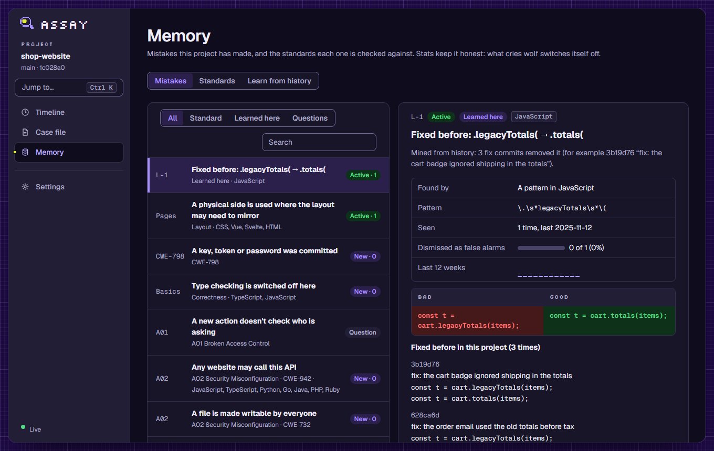

# Memory

What Assay remembers about a project: the mistakes it has made before, the standards it is checked against, and what its own git history teaches. Back to the [README](../README.md).

Memory does three things, and only these:

1. **Names what a finding is an instance of.** A finding that matches a remembered mistake says so: how often it has been seen in this project, how often it was a false alarm, and what it is checked against (a standard, or the project's own fixes).
2. **Keeps score, so a noisy check switches itself off.** Every finding counts as a hit; every dismissal is a false alarm. An entry that keeps crying wolf stops being reported.
3. **Learns patterns from the project's own fix commits**, and asks a person before adding any.

It does not make a model smarter, it does not upload anything, and it cannot turn a hint into proof or block a merge. It needs Node 22.13 or newer (it uses the SQLite built into Node). On an older Node, memory is off, says why, and nothing else changes.



## The screen, the commands, the tool

| | |
|---|---|
| **Dashboard** | *Memory* in the sidebar: **Mistakes** (every entry and its stats), **Standards** (the packs, on or off), **Learn from history**. In a case file, a finding that matches an entry shows it under the finding. |
| **Command line** | `assay memory` and its subcommands, below. |
| **MCP** | One read-only tool, `memory`: which remembered mistakes a case's findings match, and the questions worth asking. An agent can't add, switch off or forget anything. |

```bash
assay memory                       # what is in memory, and what is crying wolf
assay memory list [--kind standard|learned|questions] [--all]
assay memory show <entry>          # detector, stats, an example
assay memory packs                 # the standards packs
assay memory pack <id> on|off
assay memory on|off <entry>
assay memory mine [--limit n]      # read the git history for what fixes keep removing
assay memory add <suggestion>      # add one of those (nothing is added until you do)
assay memory add --name "…" --pattern "…" [--langs "TypeScript,JavaScript"] [--good "…"] [--bad "…"] [--ref "…"]
assay memory remove <L-n>          # forget a learned entry
assay memory questions [--langs "Python,CSS"]
assay memory import <file>         # check a pack file and copy it into your packs folder
```

## Entries

An **entry** is one mistake, with something that finds it:

| | Where it comes from | What finds it |
|---|---|---|
| **Standard** | a pack file (below) | Assay's own checks, named by the evidence they produce (`rule:html-injection`, `browser:contrast`, `fact:*`); or nothing, when it is a **question** for a reviewer |
| **Learned** | this project's own history, or added by hand | a **pattern**: a literal, escaped from a token that fixes keep removing, run on the lines each commit adds |

An entry's id is `<pack>/<rule>` for a standard entry (`owasp-top10/a05-html`) and `L-<n>` for a learned one. A **question** is an entry no machine can decide ("does every new route check who is asking?"). It is shown, counted, and handed to a reviewer through `assay memory questions` and the MCP tool; it never produces a finding.

### What a learned pattern does when it fires

A learned pattern is a **signal**, never proof (D33):

- It produces `rule` evidence with the source `memory:L-1`.
- If it came from fix commits it also produces `history` evidence: *"This project fixed the same pattern 3 times before (for example 91c4d20 “fix: …”)."* Two independent signals make the finding **corroborated**.
- A pattern added by hand with no fixes behind it is one signal: a **hint**.
- It is never more than medium severity, so it can ask for a look and **can never block a merge**.
- It runs on added lines only, in non-test, non-generated, non-demo files of the languages it names.

## Stats, and what makes an entry cry wolf

Stats are **read from a table of hits, never counted up**, so they can't drift (D31).

- A **hit** is a finding that belongs to an entry, once per finding, dated by its commit. Opening the same case again does not count it again. A finding that a later commit in the range already fixed still counts: it was committed.
- A **false alarm** is a hit a person **dismissed**. *Mark as intended* is a real hit that was meant, not a false alarm. Undoing either takes it back.
- Each entry shows hits, false alarms, the last hit and the last twelve weeks.

| Status | Meaning |
|---|---|
| **New** | no hits yet |
| **Active** | has hits, mostly real |
| **Expiring** | at least 3 hits and at least 30% of them dismissed |
| **Cried wolf** | it switched itself off |
| **Off** | switched off by a person, or its pack is |
| **Question** | a question for a reviewer |

**Expiry** (D32): an entry switches itself off when it has **at least 4 hits**, **30% or more dismissed**, and **no real hit for 60 days**. A person who switches it back on gets 60 days before it can expire again. Only a *signal* can expire (`rule:`, `diff:` and learned patterns). Proof never does: a committed key, a measured overlap, a failing test are never muted, whatever their entry says.

An entry that is off is skipped when a commit is analysed, so the timeline and the case file agree with each other. Memory is part of the key of the cache of each commit's analysis: switching something off, or learning a pattern, makes the commits you look at next be analysed again (a few seconds per ten commits). Nothing else is ever analysed twice.

## Standards packs

A pack is a plain JSON file. Assay ships six; yours go in `~/.assay/packs`, and a pack of yours with the same `id` replaces the bundled one. A new edition of a standard is a file update, not a release.

| Pack | What it holds |
|---|---|
| **OWASP Top 10 (2025)** | the ten categories, [as OWASP lists them](https://owasp.org/Top10/2025/). Which of Assay's checks sit under each one is Assay's own mapping. Categories no check can decide become questions. |
| **WCAG 2.2 AA** | the criteria the browser checks measure (1.1.1, 1.3.1, 1.4.3, 1.4.10, 4.1.2) and five that need a person with a keyboard |
| **Tests** | focused or skipped tests, a removed assertion, logic with no test, deleted tests, a regression, a surviving mutant, a risky change nothing notices |
| **Pages** | what opening the page in a real browser can measure: overlap, cut-off text, a blank page, errors, failed requests, a physical side where the layout may mirror |
| **Basics** | a committed secret, type checking switched off |
| **Review questions (starter)** | nine questions about money, timeouts, bounds, time zones, migrations, translation, partial failure, error messages and defaults |

A pack on or off is kept per repository. Rules that no enabled pack asks for are skipped, so turning **OWASP Top 10** off stops `eval` and `innerHTML` findings in that project. A rule that no pack mentions always runs.

### Writing or importing a pack

```json
{
  "id": "my-rules",
  "name": "My team's rules",
  "edition": "v3",
  "source": "https://example.com/our-rules",
  "note": "Plain words about what this is.",
  "on": true,
  "rules": [
    { "id": "no-eval", "name": "Code is built from a string", "ref": "Rule 12",
      "sources": ["rule:eval", "rule:eval-py"], "langs": ["JavaScript", "Python"],
      "bad": "eval(input)", "good": "a lookup table" },
    { "id": "who-is-asking", "name": "A new action doesn't check who is asking",
      "question": "Does every new route check, on the server, who is asking?" }
  ]
}
```

A question can say which [reviewer](REVIEWERS.md) it is for with `"lens"` (`Security`, `Correctness`, `UI`, `Tests`, `Supply chain`, `Scope` or `Performance`; without one, `Correctness`): each reviewer's brief includes the questions for its lens. Each rule needs a `name` and either `sources` (the evidence Assay's own checks produce that this rule is about) or a `question` (a reviewer decides). `assay memory import my-rules.json` checks the file field by field and copies it into your packs folder. A file that doesn't pass is skipped and reported (`assay memory packs`, and the Standards tab), never half loaded.

| Source | What produces it |
|---|---|
| `rule:<id>`, `diff:<id>` | the free checks ([all of them](CHECKS.md)) |
| `browser:<kind>` | `assay look`: `overlap`, `clip`, `contrast`, `hscroll`, `noalt`, `noname`, `nolabel`, `blank`, `exception`, `console`, `network`, `probe` |
| `proof:<kind>`, `coverage:<kind>` | `assay prove` |
| `fact:*` | a committed secret (a trailing `*` matches the rest) |

The OWASP Top 10 for Agentic Applications, the CWE Top 25 and a team's own senior checklist are the kind of thing a pack file is for; Assay doesn't ship them because it can't vouch for their text, and an edition is a choice to make. Import the one you use.

## Learning from history

`assay memory mine`, or *Learn from history* in the dashboard, reads git only (nothing is run):

1. It finds the **fix commits**: a subject starting `fix:`, `fix(scope):`, `bugfix:` or `hotfix:`, or saying *fix*, *fixes*, *fixed*, *bugfix* or *hotfix* (not `docs:`, `chore:`, `refactor:`, reverts and the like). Up to 600 commits, newest first (`--limit`, up to 2,000). Bulk changes (over 60 files or 2,000 lines) and generated, test, doc and demo files are left out.
2. In each changed hunk it keeps what the change **took away**: a call (`name(`), a member (`.name`, `.name(`), `new Name(`, or in CSS a declaration with its numbers made generic (`right: Npx`). Text inside strings and comment lines is ignored.
3. A token is a **suggestion** when at least two fix commits removed it, fixes remove it far more often than other commits do, and the fixes did **the same thing with it** each time: swapped it for the same new token, or took it out. That last test is what separates a recurring mistake from a name that merely appears in edits.
4. The pattern is the token's own characters, escaped, with a number standing for any number. Nothing a person typed becomes a pattern here.

Each suggestion shows how many fix commits removed it, how many other commits did, what the fixes usually put in its place, and an example. **Worth a detector** means at least three fixes, a ratio of at least one half and the same action at least 60% of the time.

**What it can't find.** It finds recurring things to avoid: an old function that was replaced, a property that kept being removed, a CSS declaration that kept being changed. It cannot find a logic slip like `<` where `<=` was meant, because that has no shape to find. Most fixes are logic, so **an honest answer is often "no pattern recurs enough to suggest"**.

**Calibration (D11).** On three real repositories (66 to 1,000 commits, 12 to 164 fixes) the first version suggested the project's own names, such as a state setter or a ref's `.current`, because fix commits touch them. Requiring the same action each time removed them, and none of the three then had a suggestion it called worth a detector. A test with a planted history (`memory.test.ts`) pins the case where one does recur.

*Add detector* (or `assay memory add <suggestion>`) adds a suggestion as a learned entry. From then on it runs on the lines each commit adds. A suggestion can only be added from the last reading of this project's history: neither the page nor an agent can send a pattern of its own through that route.

### Patterns added by hand

`assay memory add --name … --pattern …` is for a pattern you wrote. It is checked: at most 200 characters, only the `i` flag, valid, no group that repeats a repeat (which can run for ever), and not so broad that it matches almost every line.

## Where it is kept

| | |
|---|---|
| `~/.assay/memory.db` | SQLite (`node:sqlite`): `learned` (your patterns), `hits` (one row per finding per entry), `switches` (what is on or off, and whether a person or expiry did it). Every row is keyed by the repository, so projects never see each other's stats. |
| `~/.assay/packs/*.json` | your packs |
| `~/.assay/mined/<repo>.json` | the suggestions from the last reading of a project's history |
| `packages/core/assets/packs/*.json` | the packs that ship with Assay |

Learned entries are numbered across all projects (`L-1`, `L-2`, …), so an id never means two things. Nothing in memory leaves the computer. Examples and notes are masked like everything else Assay keeps: a secret that was in a fix commit's line is never written to the database.

## What can go wrong

See [Troubleshooting](TROUBLESHOOTING.md#memory). The short version: *Memory is off* means an old Node or an unreadable `memory.db` (move it away and a new one is made); *A pack file was skipped* names the file and the field; an entry that seems to have vanished may have switched itself off, and `assay memory list --all` shows it.
