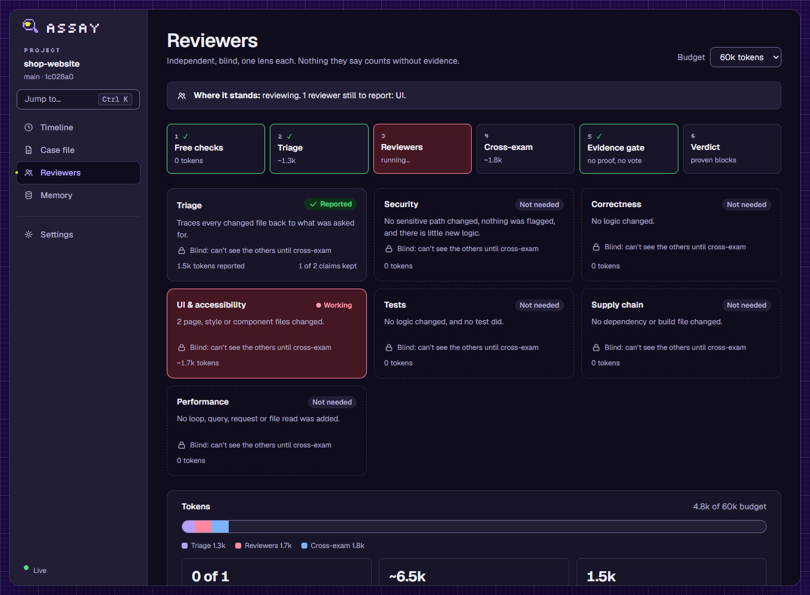

# Reviewers

A panel of reviewers, each looking through one lens, blind to the others, and nothing they say counts without evidence. Back to the [README](../README.md).

**Assay never calls a model.** It has no key, no account and no network. The reviewers are sub-agents of the agent you already use (Claude Code, for instance). What Assay does is the part that is easy to get wrong:

- it works out **who is worth running** for this change, and **what that costs, before anything is spent**;
- it hands each reviewer **only its own slice** of the change, with the line numbers a claim must cite, and never another reviewer's work;
- it counts what comes back through the **evidence gate**, and runs **cross-examination** between reviewers;
- it can stop an agent from saying **"done"** while its own verdict is Blocked (the Stop hook).



The free checks always come first and cost nothing. Reviewers are for judgment the free checks can't make, and they only look where the change touches their lens.

## The reviewers

| Reviewer | Lens | Runs when |
|---|---|---|
| **Triage** | Scope | you gave the request. It traces each changed file back to it and reports what the request doesn't explain. It is shown file names and counts, never code. |
| **Security** | Security | the free checks flagged a security pattern, a sensitive path changed (auth, payment, schema, …), or 40 or more lines of logic were added |
| **Correctness** | Correctness | 10 or more lines of logic changed, or the free checks flagged something |
| **UI & accessibility** | UI | a page, style or component file changed |
| **Tests** | Tests | a test file changed, or logic changed and no test did |
| **Supply chain** | Supply chain | a dependency, lockfile, CI or container file changed |
| **Performance** | Performance | an added line starts a loop, a query, a request or a file read |

Each one's prompt is a plain Markdown file you can read and change: `packages/core/assets/lenses/*.md`, and a file of yours with the same name in `~/.assay/lenses` replaces it.

## The plan, and the cost, before you spend

```bash
assay reviewers --budget 40k --request "show coupon errors in the cart"
```

```
Reviewer panel for case c-… · budget 40k tokens · about 11.5k (reviewers 7k, cross-examination 4.5k)

RUN   Triage              ~1.3k   Traces every changed file back to what was asked for.
RUN   Security            ~1.5k   The free checks flagged 2 security patterns.
RUN   Correctness         ~1.4k   14 lines of logic changed.
RUN   UI & accessibility  ~1.4k   1 page, style or component file changed.
RUN   Tests               ~1.4k   Logic changed and no test did.
skip  Supply chain                not needed: No dependency or build file changed.
skip  Performance                 not needed: No loop, query, request or file read was added.

Not spent: about 2.6k on lenses this change doesn't touch.
```

- **Routing** is plain facts about the change (above). A reviewer the change doesn't touch costs nothing and says why it was left out.
- **The estimate** counts characters: the shared rules, the reviewer's prompt, its slice, what the free checks already know, plus 700 tokens to answer, at about four characters to a token. It is rough on purpose and says so; the agent can report what it actually used.
- **The budget** is spent on the reviewers the facts justify, most justified first (more free findings in a lens, then a fixed order: Security, Correctness, UI, Tests, Supply chain, Performance), keeping room for cross-examination. One that doesn't fit says `Over budget: needs 4.8k, 1.2k left`. A budget of `free` turns every reviewer off. The default is 40k, kept per project: `assay reviewers budget 20k`, or the budget box on the dashboard. `--budget` on a command applies to that run only.

`assay reviewers` only shows the cost and keeps nothing. `assay reviewers plan` keeps the plan with the case, so an agent that is told to run it finds the same one.

## Running it

You ask your agent. The dashboard's Reviewers screen (or `assay reviewers plan`) gives you the words:

> Review case c-… with Assay's reviewer panel. Call the assay tool `reviewers_plan` with case "c-…", budget 40000, and follow what it says: start one sub-agent per reviewer it lists, in parallel, each told only to call `reviewer_brief` for its own lens and follow it. Don't show the reviewers each other's work. When `reviewers_plan` says the panel is done, call `case_open` again and tell me the verdict.

Then, in the agent's own session:

1. **`reviewers_plan`** shows the plan and cost again, keeps it, and says exactly which sub-agents to start and what to tell each (one short sentence).
2. Each sub-agent calls **`reviewer_brief`** for its lens and gets its brief (below). It reads the slice, and reports with **`finding_submit`**: its claims, `done: true`, and optionally how many tokens it used. With nothing to report it sends no claims and `done: true`: silence is a valid answer, and a reviewer must say it is done or Assay can't tell "found nothing" from "still working".
3. When every planned reviewer has reported, `reviewers_plan` opens **cross-examination** (below) and names the examiners to start.
4. When it says the panel is done, the agent reads the verdict again with `case_open`.

You can also hand a reviewer its brief yourself, in any chat: `assay reviewers brief security`.

## What a reviewer is handed

A brief is one reviewer's lens and nothing else:

- the shared rules (cite a line in the change; say what you observed apart from what you infer; no style opinions; silence is fine; you can't claim proof);
- the lens prompt;
- **its slice**: only the files its lens is about, printed with the numbers a claim must cite (`+` for an added line, `−` for a removed one, with context). Security sees source and sensitive files, UI sees pages and styles, Supply chain sees manifests, Triage sees names only. A long change comes in pages;
- **what the free checks already found for that lens**, so it doesn't repeat it;
- **the questions this project's [memory](MEMORY.md) asks of every change in that lens** ("is every new piece of text translatable?").

It is **never shown another reviewer's work**, and **secrets in the diff are masked**, as they are everywhere else Assay writes code out: a brief goes into a model's context.

## Cross-examination

Reviewers who work alone make mistakes nobody catches, and agree by accident. When every planned reviewer has reported, each claim only one reviewer made goes to **one other reviewer, never its author**, anonymously (up to five claims each). The examiner looks at the lines itself and either:

- **confirms** it, with a claim of its own at the same file and line and its own evidence. Two reviewers who each saw it make the finding **corroborated**;
- **disputes** it, with a reason. The dispute is shown on the screen and under the finding. It changes no tier: what one reviewer says alone stays a hint;
- or says nothing.

## The attack pass

One more reviewer, outside the lenses, whose only job is to **break the change**. It is told to find the input, the order of events or the state that makes the changed code do the wrong thing, and to say, for each break, the concrete input or sequence, what the code does with it (citing the line) and what should have happened. A break it can't tie to a changed line is not a finding.

- **On offer only on a big budget** (80k tokens or more), because it reads every changed file that runs or is shown (not tests, not lockfiles) and costs the most. It is planned only when a reviewer is worth running and something that runs or is shown changed, and only if it fits after the others and the cross-examination; the plan says why it runs or why it doesn't. Below 80k it is not listed.
- **Blind, like the rest.** Its brief has the changed files, the tests that changed *by name*, and what the free checks found, and never another reviewer's claims. It reports like a reviewer: `reviewer_brief` with lens `attack`, then `finding_submit` with reviewer `Attack` and `done: true`. Each claim names the lens the break belongs to (Correctness, Security, UI, ...), so no finding is ever "about attack".
- **The same gate.** A claim must cite a changed line. At a line the free checks already flagged it is a second source (corroborated); elsewhere it is a hint. It can't claim proof, and nothing it says blocks a merge.
- **Cross-examination waits for it**, and then another reviewer examines what only the attacker claimed, like any other claim.
- Its prompt is a Markdown file, `attack.md`: yours in `~/.assay/lenses` replaces the one that ships.

Assay still never calls a model: your agent runs the attack pass as one more sub-agent. Calibration scores it on a row of its own, since it has no lens: what it flagged, and how much of that nothing else did ([the attack pass, scored](CALIBRATION.md#the-attack-pass-scored)).

## What reviewers can and can't do

- A reviewer's finding is **at best corroborated**. It asks for a look; it **never blocks a merge** (only proof blocks, and only Assay produces proof).
- A claim must cite a changed line, or it is **dropped** and the screen says why. Anything a claim calls a failing test is kept as the reviewer's reading, marked `[unverified]`.
- An agent can ask for a plan, fetch briefs and report. It can't spend tokens through Assay (there is nothing to spend), turn running code on, or dismiss a proven finding.

## The Stop hook

A coding agent can say "done" while its change is broken. The Stop hook stops that:

```bash
assay hook install      # prints what to add to your agent's settings; Assay doesn't edit them
```

When the agent is about to stop, Assay reviews the branch **itself** (not on the agent's say-so). If the verdict is **Blocked**, the agent is told what to fix and carries on. Otherwise it stops as usual.

- It only looks at a branch that has **left the default branch** (`--always` also reviews the last commits on it), and only blocks what Assay can **show** is wrong.
- `--require-panel` also waits for a panel you planned to finish.
- It **lets go after 2 tries in a row** on the same state (`--max-blocks`), so it can never trap a session; each session is counted on its own.
- Uncommitted changes aren't reviewed (Assay reads commits): it says so.

## On the screen

The **Reviewers** screen shows the plan and its cost (a preview until you plan), the six steps (free checks, Triage, reviewers, cross-exam ("cross-exam + attack" when the attack pass is planned), evidence gate, verdict), a card per reviewer (will run, waiting, working, reported, or why not), the token meter, what the gate kept and dropped, any disputes, and the words to give your agent. While a panel is running it follows what the agent reports. The case file's verdict card says where the panel stands, and a disputed claim says so under the finding. [The dashboard guide →](DASHBOARD.md)

## Calibration

Which reviewer earns its tokens is measured, not believed: [calibration](CALIBRATION.md) plants known bugs and scores each reviewer. One that caught none of the bugs planted in its lens in its last two runs is **left out of the plan** (it says so, and `--include` brings it back).

## Not built

Assay can't start the sub-agents itself, because that would mean running a model, and it doesn't; if you want that, a runner is a separate, optional tool. Token usage is an estimate unless the agent reports it.
